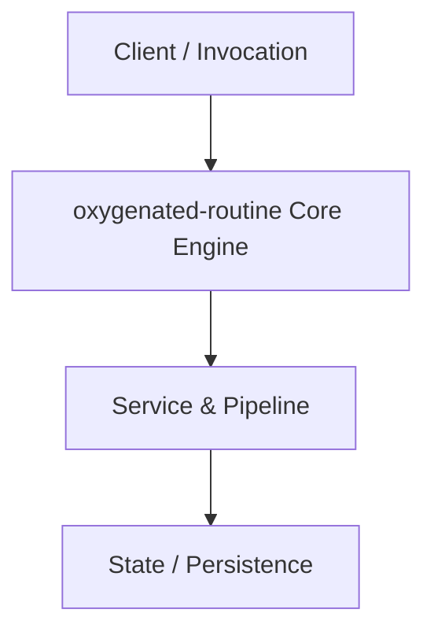

<p align="center">
  
</p>

<h1 align="center">oxygenated-routine</h1>

<p align="center">
  <em>Autonomous software engineering & algorithmic system for oxygenated-routine.</em>
</p>

<p align="center">
  
  
</p>

---


## 📖 Overview
Autonomous software engineering & algorithmic system for oxygenated-routine.

## 🚀 Key Features
- **Architecture**: Modular, robust, high-efficiency design optimized for low-latency execution.
- **Reliability**: Strictly validated pipelines, continuous verification, and resilient fallbacks.
- **Developer Experience**: Modern styling, clear contracts, and deterministic configurations.

## 🛠️ Getting Started

### Prerequisites
- Git
- Applicable runtime/compiler toolchain for this codebase

### Setup
```bash
git clone https://github.com/seeramsujay/oxygenated-routine.git
cd oxygenated-routine
```

## 📐 Architecture


## 📄 License
Refer to the `LICENSE` file in this repository for distribution and usage rights.
